# AgriSentinel — Precision Agriculture Rover Platform

<div align="center">

[](LICENSE)
[](https://www.python.org/)
[](https://fastapi.tiangolo.com/)
[](https://react.dev/)
[](https://www.typescriptlang.org/)
[](https://vitejs.dev/)
[](https://ultralytics.com/)
[](https://opencv.org/)

**Intelligent field inspection, crop monitoring, and precision-agriculture rover simulation.**

[Overview](#overview) • [Key Features](#key-features) • [System Architecture](#system-architecture) • [Screenshots](#application-walkthrough--screenshots) • [Quick Start](#quick-start) • [Documentation](#documentation) • [Limitations](#limitations) • [Author](#author)

</div>

---

> [!NOTE]
> **Simulation-First Platform**: AgriSentinel is a software-in-the-loop research, inspection, and robotics simulation platform. No physical rover hardware or chemical spraying actuators are connected in this software distribution. All field coordinates are estimated using planar homography.

---

## Overview

Modern agricultural operations face substantial economic and environmental costs from broadcast herbicide and pesticide spraying. Indiscriminate chemical application damages soil microbiomes, accelerates weed resistance, and leads to costly chemical runoff into local watersheds.

**AgriSentinel** delivers an end-to-end precision agriculture intelligence platform uniting:
1. **Computer Vision & Agricultural Detection**: OpenCV preprocessing (CLAHE contrast normalization, bilateral filtering) paired with Ultralytics YOLOv8 object detection and classical vegetation color-segmentation fallback.
2. **Planar Homography & Target Localization**: Projecting pixel-space weed and crop detections onto metric 2D field coordinates.
3. **Autonomous Rover Simulation**: 2D differential-drive kinematics, trajectory planning, waypoint navigation, and collision avoidance.
4. **Multi-Tier Interlocked Safety**: Mandatory operator authorization, velocity thresholds, geo-fence boundaries, and instant Emergency Stop.
5. **Agronomic History & Analytics**: Local SQLite database logging inspections, target lifecycles, and intervention records with CSV export.

---

## Key Features

- 🛰️ **Vision Lab**: Ingest agricultural RGB imagery or video streams, execute real OpenCV + YOLOv8 inference, and render color-coded bounding boxes with confidence scores.
- 📷 **Live Monitoring**: Web-based camera module supporting live webcam acquisition, frame capture, and immediate inference.
- 🎯 **Target Prioritization**: Multi-factor scoring engine ranking detected weeds based on confidence, weed species severity, and rover proximity.
- 🗺️ **2D SVG Field Map**: Interactive vector map displaying field boundaries, crop rows, rover heading, and active/completed targets.
- 🚜 **Kinematic Rover Simulator**: Deterministic 11-state machine (`IDLE`, `READY`, `NAVIGATING`, `ARRIVED`, `INTERVENTION_PENDING`, `SAFETY_LOCK`, etc.) with continuous velocity integration.
- 🛡️ **Safety-Gated Actuator**: Virtual spot intervention requiring 5 independent safety gates to pass before simulated treatment executes.
- 📊 **Real-Data Analytics**: Detections over time, target status distributions, and operation duration computed directly from local database records without fabricated metrics.
- ⚙️ **Configurable System Settings**: Adjustable confidence thresholds, detection backend preferences (`auto`, `yolo`, `classical_heuristic`), and field geometry management.

---

## System Architecture

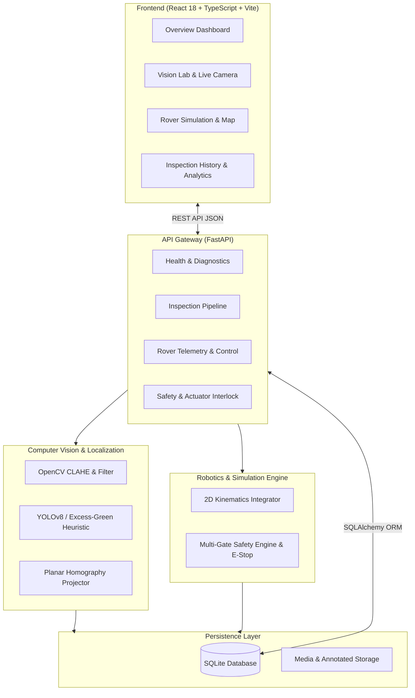

---

## Application Walkthrough & Screenshots

### 1. Operations Overview Dashboard
Aggregates field parcel statistics, total targets, intervention tallies, rover readiness, and system health status in real time.
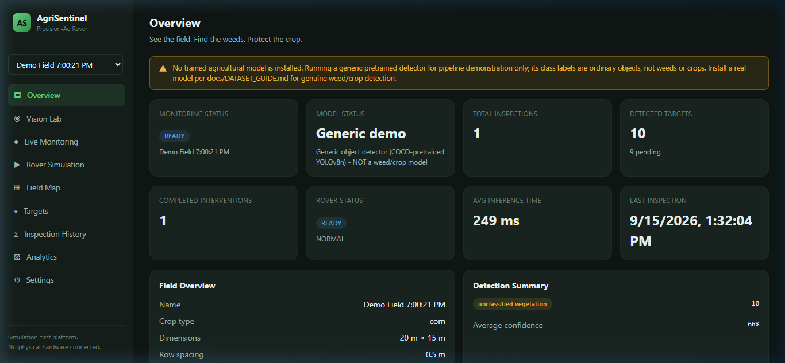

---

### 2. Vision Lab — Image Ingestion & OpenCV Inference
Upload raw field imagery or load sample agricultural scenes. The vision pipeline normalizes illumination with CLAHE and isolates weed targets.
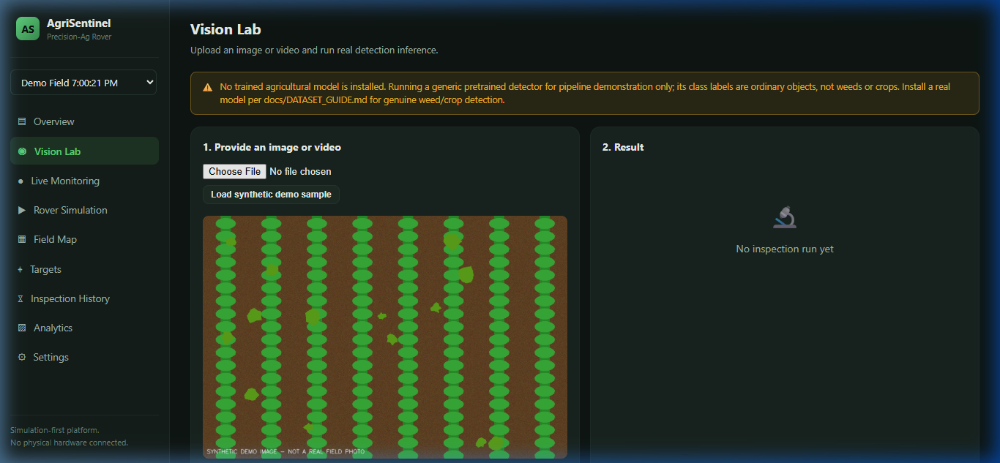
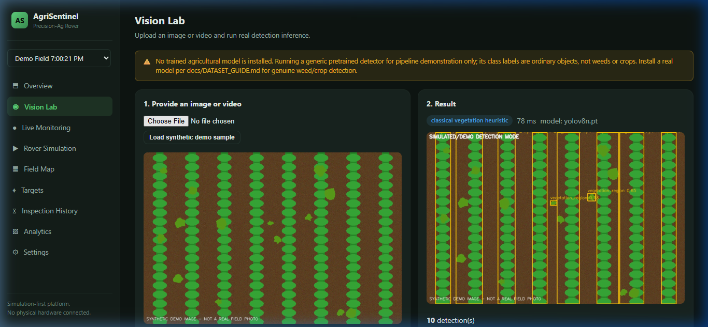

---

### 3. Target Management & Operator Review
Review detected weed waypoints, examine priority scores, and explicitly authorize targets for robotic intervention.
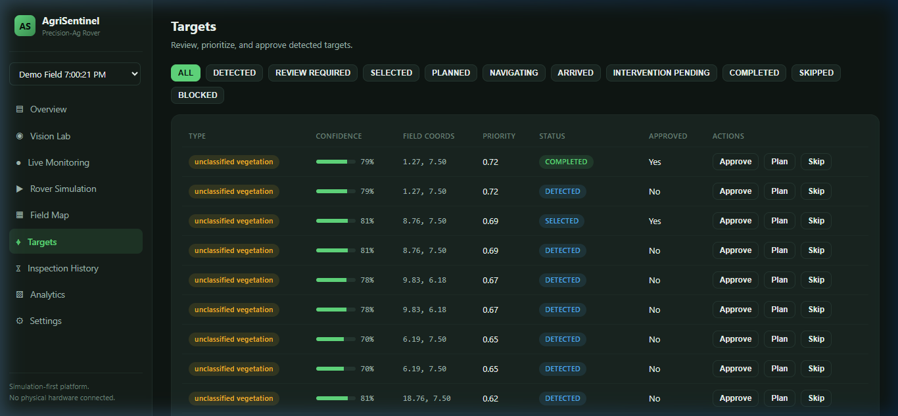

---

### 4. 2D Interactive Field Map
Visualizes parcel boundaries, parallel crop rows, localized weed targets, and rover spatial coordinates.
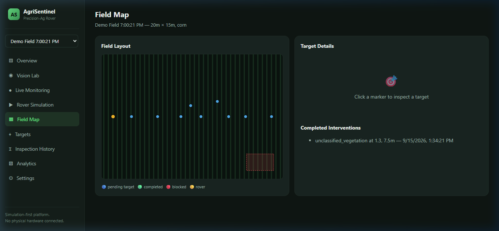

---

### 5. Autonomous Rover Simulation & Live Telemetry
Drives the virtual differential-drive rover along planned trajectories to target coordinates with continuous telemetry streaming.
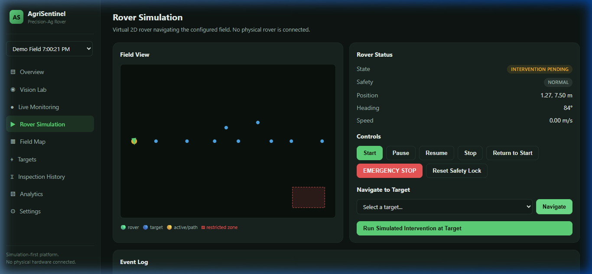
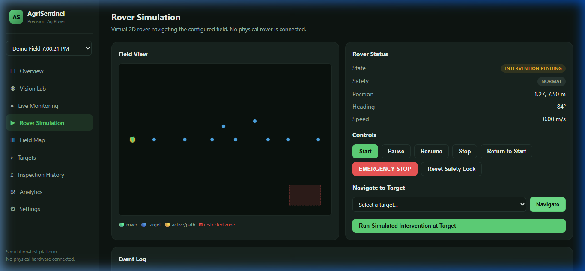

---

### 6. Safety-Interlocked Virtual Intervention & Emergency Stop
Demonstrates operator confirmation gating and immediate fail-safe lock upon Emergency Stop activation.
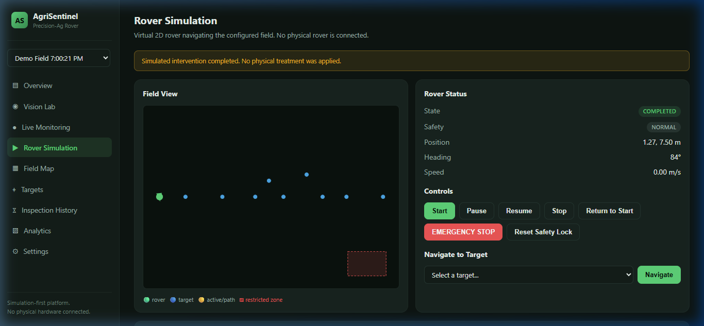
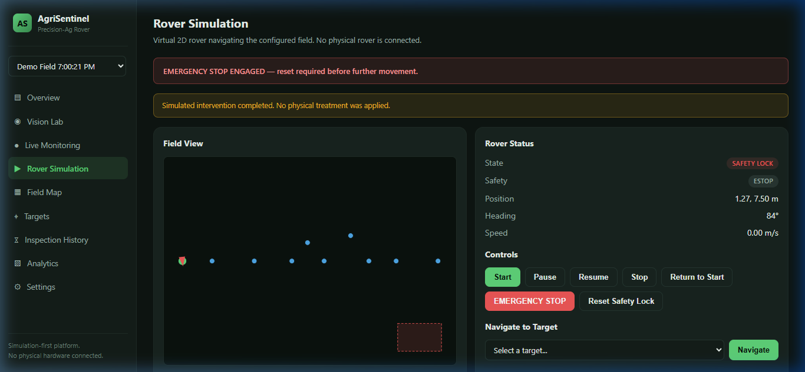

---

### 7. Inspection History & Agronomic Analytics
Auditable records of all field passes, processing durations, and target resolution efficiency stored in SQLite.
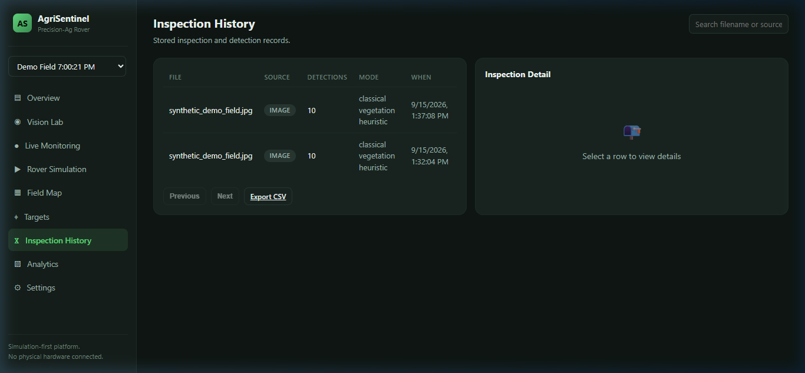
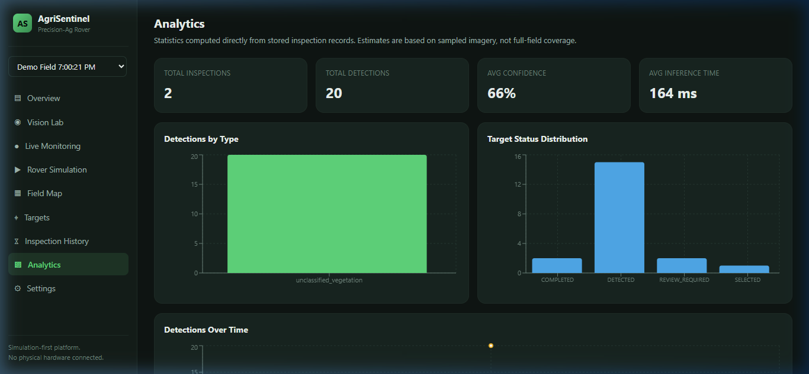

---

### 8. Interactive OpenAPI Documentation
Full Swagger documentation for all 20+ REST API endpoints.
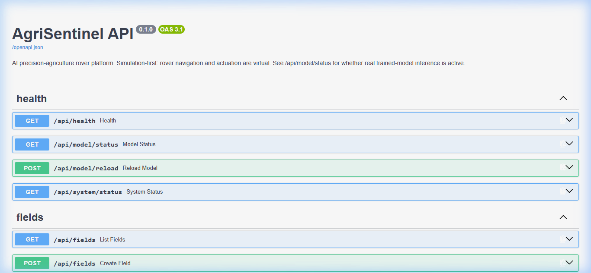

---

## Repository Structure

```text
AgriSentinel/
├── backend/                  # FastAPI Python backend
│   ├── app/
│   │   ├── api/              # Modular REST endpoint routers
│   │   ├── models/           # SQLAlchemy database entities
│   │   ├── schemas/          # Pydantic validation schemas
│   │   ├── services/         # CV inference, rover kinematics, safety engine
│   │   ├── config.py         # Application configuration & env vars
│   │   ├── database.py       # Database session engine & table init
│   │   └── main.py           # FastAPI application entrypoint
│   ├── tests/                # Pytest automated test suite (31+ tests)
│   └── requirements.txt      # Python dependencies
├── frontend/                 # React 18 + TypeScript + Vite frontend
│   ├── src/
│   │   ├── components/       # Reusable UI components & layouts
│   │   ├── pages/            # View pages (Overview, VisionLab, Rover, Map, etc.)
│   │   ├── state/            # React Context state management
│   │   ├── types/            # TypeScript interfaces and data models
│   │   ├── App.tsx           # Router and main layout shell
│   │   ├── index.css         # High-density dark mission-control design system
│   │   └── main.tsx          # Frontend entrypoint
│   ├── package.json          # Node dependencies & scripts
│   └── vite.config.ts        # Vite build & proxy configuration
├── docs/                     # Technical documentation & architecture guides
│   ├── screenshots/          # High-resolution application screenshots
│   ├── PROJECT_OVERVIEW.md   # Mission, problem statement, and pillars
│   ├── PRD.md                # Product requirements document
│   ├── SYSTEM_ARCHITECTURE.md# Full architecture & Mermaid diagrams
│   ├── TECHNICAL_DESIGN.md   # Mathematical models & kinematics
│   ├── WORKFLOW.md           # End-to-end operational lifecycle
│   ├── COMPUTER_VISION.md    # Preprocessing & YOLO/HSV pipeline
│   ├── DATASET_GUIDE.md      # Agricultural datasets & labeling
│   ├── MODEL_TRAINING.md     # YOLOv8 fine-tuning & export guide
│   ├── TARGET_LOCALIZATION.md# Homography & camera calibration
│   ├── ROVER_SIMULATION.md   # Rover kinematics & state machine
│   ├── SAFETY.md             # Multi-tier safety gates & E-Stop
│   ├── HARDWARE_INTEGRATION.md# Transition roadmap to physical robotics
│   ├── API_REFERENCE.md      # OpenAPI/REST API endpoint specifications
│   ├── DATABASE_SCHEMA.md    # ERD diagram and SQLite schema
│   ├── TESTING.md            # Test suite execution & verification
│   ├── DEPLOYMENT.md         # Local & containerized deployment
│   ├── DEMO_SCRIPT.md        # 5-minute hackathon presentation script
│   └── LIMITATIONS.md        # Honest system boundaries
├── ml/                       # YOLO model training & export scripts
│   ├── train.py              # Ultralytics fine-tuning wrapper
│   ├── validate.py           # Evaluation & mAP benchmark script
│   └── export.py             # ONNX / TensorRT weight exporter
├── models/                   # Custom model weight checkpoints (.pt)
├── data/                     # SQLite database & runtime media uploads
├── scripts/                  # Helper utilities (synthetic sample generator)
├── CONTRIBUTING.md           # Contribution guidelines
├── LICENSE                   # MIT License (Daanial Baig)
├── .env.example              # Environment variable template
└── .gitignore                # Comprehensive Git ignore rules
```

---

## Quick Start

### Prerequisites
- **Python 3.12+**
- **Node.js 18+ & npm**
- **Git**

### 1. Clone the Repository
```bash
git clone https://github.com/daanialmirza5/AgriSentinel.git
cd AgriSentinel
```

### 2. Backend Setup
```powershell
# Create and activate Python virtual environment
python -m venv .venv
.\.venv\Scripts\activate

# Install dependencies
pip install -r backend/requirements.txt

# Start the FastAPI backend
$env:PYTHONPATH="backend"
python -m uvicorn app.main:app --host 127.0.0.1 --port 8000 --reload
```
*Backend runs on `http://127.0.0.1:8000` (Interactive API Docs: `http://127.0.0.1:8000/docs`).*

### 3. Frontend Setup
```powershell
# In a separate terminal
cd frontend
npm install
npm run dev
```
*Open your browser at `http://localhost:5173`.*

---

## Running Tests

Run the complete backend automated test suite:

```powershell
.\.venv\Scripts\python.exe -m pytest backend/tests -v
```

All 31+ unit and integration tests pass cleanly, verifying:
- System health and field parcel CRUD.
- Image ingestion, validation, and CV preprocessing.
- Target lifecycle transitions and priority calculations.
- Rover kinematic simulator, waypoint arrival, and telemetry.
- Multi-tier safety interlocks and Emergency Stop behavior.
- Database persistence, settings round-trip, and CSV exports.

---

## 5-Minute Demo Walkthrough

1. Open `http://localhost:5173/`.
2. Go to **Settings** $\rightarrow$ Click **Create Demo Field** (creates `North Parcel Alpha`, $50\text{m} \times 30\text{m}$).
3. Go to **Vision Lab** $\rightarrow$ Click **Load synthetic demo sample** $\rightarrow$ Click **Run Inference**.
4. Review annotated weed detections and confidence metrics.
5. Go to **Targets** $\rightarrow$ Click **Approve** on target `#1`.
6. Go to **Field Map** to view the target waypoint positioned on the field grid.
7. Go to **Rover Simulation** $\rightarrow$ Click **Start Rover** $\rightarrow$ Select Target $\rightarrow$ Click **Navigate to Target**.
8. Watch the rover navigate along its trajectory until reaching `INTERVENTION_PENDING`.
9. Click **Run Simulated Intervention at Target** to execute the safety-interlocked treatment.
10. Click **Emergency Stop** to verify fail-safe lock behavior, then click **Reset Safety Lock**.
11. Check **Inspection History** and **Analytics** to audit the real recorded data.

---

## Safety Disclosures & Limitations

- **Simulation-First**: Navigation and actuation are executed purely in software simulation. No physical rover or chemical sprayer is controlled.
- **Estimated Localization**: Planar homography coordinates are calculated for demo geometry; physical deployment requires intrinsic camera calibration and RTK-GPS.
- **Honest Detection Metrics**: Without a custom-trained agricultural checkpoint in `models/`, the system runs a clearly-labeled classical color-segmentation fallback.
- **Human-in-the-Loop**: Operator confirmation is required by default before simulated intervention executes.

See [Limitations](docs/LIMITATIONS.md) and [Hardware Integration](docs/HARDWARE_INTEGRATION.md) for full details.

---

## Documentation Index

| Document | Purpose |
| :--- | :--- |
| [Project Overview](docs/PROJECT_OVERVIEW.md) | High-level mission, challenges, and value propositions |
| [PRD](docs/PRD.md) | Product Requirements Document and user stories |
| [System Architecture](docs/SYSTEM_ARCHITECTURE.md) | Component architecture, sequence flows, and data boundaries |
| [Technical Design (TDD)](docs/TECHNICAL_DESIGN.md) | Kinematics equations, homography math, and state machines |
| [End-to-End Workflow](docs/WORKFLOW.md) | Step-by-step visual and technical mission lifecycle |
| [Computer Vision](docs/COMPUTER_VISION.md) | OpenCV preprocessing, CLAHE, and YOLO/HSV inference |
| [Dataset Guide](docs/DATASET_GUIDE.md) | Agricultural dataset sourcing and annotation guidelines |
| [Model Training](docs/MODEL_TRAINING.md) | YOLOv8 fine-tuning, hyperparameters, and ONNX export |
| [Target Localization](docs/TARGET_LOCALIZATION.md) | Coordinate frames and camera calibration guide |
| [Rover Simulation](docs/ROVER_SIMULATION.md) | Differential-drive kinematics and state transitions |
| [Safety & Interlocks](docs/SAFETY.md) | 5-gate safety architecture and Emergency Stop protocols |
| [Hardware Integration](docs/HARDWARE_INTEGRATION.md) | Transition roadmap to physical robotics (ROS2/Jetson) |
| [API Reference](docs/API_REFERENCE.md) | OpenAPI REST API endpoint specifications |
| [Database Schema](docs/DATABASE_SCHEMA.md) | Entity-Relationship Diagram (ERD) and table schemas |
| [Testing Guide](docs/TESTING.md) | Automated pytest suite and test coverage notes |
| [Deployment Guide](docs/DEPLOYMENT.md) | Local setup, Docker, and environment configuration |
| [Live Demo Script](docs/DEMO_SCRIPT.md) | 5-minute hackathon presentation script |
| [Limitations](docs/LIMITATIONS.md) | Transparent disclosure of system boundaries |

---

## Author

**Daanial Baig**  
GitHub: [@daanialmirza5](https://github.com/daanialmirza5)  
Email: [daanialmirza@gmail.com](mailto:daanialmirza@gmail.com)

---

## License

This project is open-source and licensed under the [MIT License](LICENSE).
