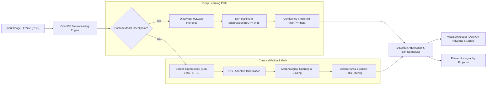

# AgriSentinel — Computer Vision & Detection Pipeline

This document details the computer vision subsystem of **AgriSentinel**, covering image preprocessing techniques, color-space transformations, YOLOv8 object detection inference, fallback heuristics, and bounding-box annotation algorithms.

---

## 1. Vision Architecture Overview



---

## 2. Preprocessing Subsystem (`backend/app/services/preprocessing.py`)

Raw agricultural imagery often suffers from extreme illumination variations, shadows from crop canopies, and dust artifacts. The preprocessing pipeline applies:

1. **Color Conversion**: Standardizes input buffers into 3-channel RGB and LAB color spaces.
2. **CLAHE (Contrast Limited Adaptive Histogram Equalization)**:
   - Applied to the Lightness ($L^*$) channel in LAB color space:
   ```python
   clahe = cv2.createCLAHE(clipLimit=2.0, tileGridSize=(8, 8))
   lab[:, :, 0] = clahe.apply(lab[:, :, 0])
   ```
   - Prevents over-amplification of noise while equalizing shadowed crop canopies.
3. **Bilateral Filtering**: Preserves sharp plant edges while smoothing sensor noise.

---

## 3. Deep Learning Pipeline: Ultralytics YOLOv8

When a custom agricultural checkpoint is provided (e.g. `models/weed_crop_model.pt`):

- **Backbone**: CSPDarknet53 with PANet neck for multi-scale feature aggregation.
- **Anchor-Free Detection Head**: Directly predicts bounding box offsets $(x, y, w, h)$ and class probability distribution.
- **Inference Configuration**:
  - Image size: $640 \times 640$
  - Confidence threshold: $\theta_{\text{conf}} \in [0.25, 0.90]$ (configurable via UI)
  - IoU threshold: $\theta_{\text{iou}} = 0.45$
- **Class Taxonomies**:
  - `0`: `crop` (Healthy main agricultural crop)
  - `1`: `weed` (Invasive non-crop vegetation requiring treatment)
  - `2`: `crop_anomaly` (Nutrient deficiency, pest damage, or chlorosis)

---

## 4. Classical Vegetation Segmentation Heuristic

If no trained model is loaded, AgriSentinel provides a transparent, deterministic fallback based on agricultural remote-sensing color indices:

1. **Excess Green Index (ExG)**:
   $$\text{ExG} = 2 \cdot G - R - B$$
   where $R, G, B$ are normalized channel intensities $[0, 1]$.
2. **Otsu Thresholding**: Computes optimal binarization threshold separating green biomass from soil substrate.
3. **Morphological Filtering**:
   - Kernel: $5 \times 5$ elliptical structuring element.
   - Morphological Opening removes single-pixel noise.
   - Morphological Closing bridges small gaps within weed leaves.
4. **Contour Extraction**: Finds connected components with area $A_{\text{min}} \le \text{Area} \le A_{\text{max}}$, extracting minimum bounding rectangles and centroids.

---

## 5. Output Annotation & Schema

The vision pipeline outputs an annotated JPEG image (with color-coded bounding boxes, class labels, and confidence tags) alongside structured JSON metadata:

```json
{
  "inspection_id": "insp_6f448a08",
  "model_backend": "classical_heuristic",
  "detection_count": 4,
  "detections": [
    {
      "id": "det_0",
      "class_name": "weed",
      "confidence": 0.85,
      "bbox": { "x": 142, "y": 88, "width": 64, "height": 72 },
      "center": { "x": 174, "y": 124 },
      "field_coords": { "x": 8.52, "y": 6.14 }
    }
  ],
  "processing_duration_ms": 42.8
}
```
