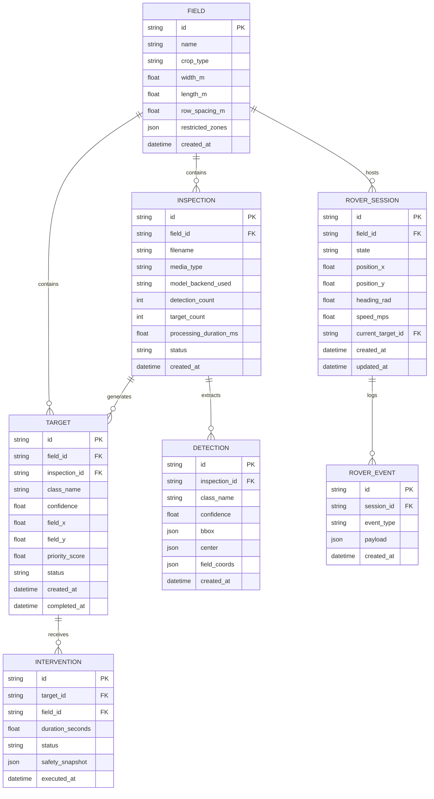

# AgriSentinel — Database Schema & Data Models

AgriSentinel utilizes **SQLite** for zero-configuration, reliable local persistence, managed via **SQLAlchemy ORM**.

---

## 1. Entity-Relationship Diagram (ERD)

---

## 2. Table Specifications

### 2.1 `fields`
Stores parcel boundaries, physical dimensions in meters, and crop metadata.
- `id` (`VARCHAR(36)`, Primary Key)
- `name` (`VARCHAR(128)`, Not Null)
- `crop_type` (`VARCHAR(64)`)
- `width_m` (`FLOAT`, default `50.0`)
- `length_m` (`FLOAT`, default `30.0`)
- `row_spacing_m` (`FLOAT`, default `0.75`)
- `restricted_zones` (`JSON`, polygon coordinate arrays)
- `created_at` (`DATETIME`)

### 2.2 `inspections`
Records each image/video uploaded, inference timing, and model checkpoint used.
- `id` (`VARCHAR(36)`, Primary Key)
- `field_id` (`VARCHAR(36)`, Foreign Key $\rightarrow$ `fields.id`)
- `filename` (`VARCHAR(256)`)
- `media_type` (`VARCHAR(32)`, `image` or `video`)
- `model_backend_used` (`VARCHAR(64)`)
- `detection_count` (`INTEGER`, default `0`)
- `processing_duration_ms` (`FLOAT`)
- `status` (`VARCHAR(32)`, `COMPLETED`, `FAILED`)

### 2.3 `targets`
Actionable weed and crop targets projected into field metric space.
- `id` (`VARCHAR(36)`, Primary Key)
- `field_id` (`VARCHAR(36)`, Foreign Key $\rightarrow$ `fields.id`)
- `inspection_id` (`VARCHAR(36)`, Foreign Key $\rightarrow$ `inspections.id`)
- `class_name` (`VARCHAR(64)`)
- `confidence` (`FLOAT`)
- `field_x` (`FLOAT`)
- `field_y` (`FLOAT`)
- `priority_score` (`FLOAT`, normalized $0-1$)
- `status` (`VARCHAR(32)`, Enum: `NEW`, `APPROVED`, `REJECTED`, `IN_PROGRESS`, `COMPLETED`, `SKIPPED`)
- `created_at` (`DATETIME`)
- `completed_at` (`DATETIME`, Nullable)

### 2.4 `interventions`
Audit trail of all simulated spot treatments and safety verification snapshots.
- `id` (`VARCHAR(36)`, Primary Key)
- `target_id` (`VARCHAR(36)`, Foreign Key $\rightarrow$ `targets.id`)
- `field_id` (`VARCHAR(36)`, Foreign Key $\rightarrow$ `fields.id`)
- `duration_seconds` (`FLOAT`)
- `status` (`VARCHAR(32)`, `COMPLETED`, `ABORTED`)
- `safety_snapshot` (`JSON`, telemetry & sensor state at time of actuation)
- `executed_at` (`DATETIME`)
