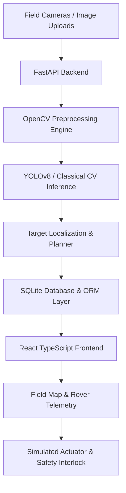

# AgriSentinel — Project Overview

> **Intelligent field inspection, crop monitoring, and precision-agriculture rover simulation.**

---

## 1. Executive Summary

Modern agriculture faces a dual challenge: maximizing crop yields to feed a growing global population while drastically minimizing chemical pesticide, herbicide, and water usage to preserve soil health and aquatic ecosystems. Traditional broadcast spraying is inefficient, applying agrochemicals indiscriminately over entire fields, leading to chemical runoff, pesticide resistance, and high input costs.

**AgriSentinel** is an open-source, simulation-first precision-agriculture software platform designed to bridge the gap between cutting-edge computer vision research and agricultural robotics. It enables agricultural researchers, robotics engineers, and agronomists to:
1. **Analyze Field Imagery**: Ingest high-resolution agricultural RGB images and video streams.
2. **Detect Weeds & Crops**: Run real computer-vision inference using YOLOv8 architectures or adaptive HSV vegetation segmentation.
3. **Localize Waypoints**: Project image-space bounding box detections onto field Cartesian coordinates.
4. **Simulate Autonomous Rover Interventions**: Plan collision-free trajectories, simulate kinematic rover movement, and execute safety-interlocked virtual actuator treatments.
5. **Track Agronomic Analytics**: Audit inspection history, target resolution rates, and operational efficiency through a local SQLite database.

---

## 2. Core Pillars

```
+-------------------------------------------------------------------------------+
|                               AGRISENTINEL                                    |
+-----------------------+-----------------------+-------------------------------+
|  1. Vision Lab & CV   |  2. Precision Mapping |  3. Robotics & Safety Engine  |
|  - YOLOv8 Inference   |  - Homography Mapping |  - Kinematic 2D Rover Sim     |
|  - HSV Segmentation   |  - Crop Row Modeling  |  - Multi-tier Safety Gates    |
|  - Real Preprocessing |  - Boundary Grids     |  - Simulated Actuator Logic   |
+-----------------------+-----------------------+-------------------------------+
```

### Pillar 1: High-Performance Computer Vision
AgriSentinel integrates OpenCV preprocessing (CLAHE contrast equalization, Gaussian smoothing, morphological opening/closing) with Ultralytics YOLOv8 object detection pipelines. When a specialized weed/crop checkpoint is mounted, the system outputs per-class detections with confidence scores and normalized bounding boxes. If no custom model is installed, it falls back to an adaptive classical vegetation color segmentation heuristic—providing immediate utility without obfuscating model status.

### Pillar 2: Coordinate Homography & Target Localization
Target localization maps 2D image coordinates $[u, v]$ to real-world metric field coordinates $[X_w, Y_w]$ via planar homography transformations. Detections are assigned priority scores based on class severity, proximity to crop lines, and detection confidence, enabling intelligent intervention ordering.

### Pillar 3: Simulation-First Robotics & Interlocked Safety
Rather than assuming direct hardware control without safety assurances, AgriSentinel employs a strict **software-in-the-loop (SITL)** rover simulator. The virtual rover navigates across a defined field boundary respecting restricted zones and obstacles. Actuation is gated behind a multi-tier safety engine requiring operator approval, valid localized coordinates, and non-emergency operating conditions.

---

## 3. Platform Architecture at a Glance



---

## 4. Key Value Propositions

| Dimension | Conventional Broadcast Farming | AgriSentinel Precision Approach |
| :--- | :--- | :--- |
| **Chemical Application** | Blanket application over 100% of field area | Targeted spot intervention on identified weed coordinates |
| **Environmental Impact** | High runoff risk into groundwater | Up to 85% reduction in theoretical chemical volume |
| **Auditability** | Manual paper logs or estimated tank usage | Every detection, coordinate, and intervention logged to database |
| **Development Cost** | Requires expensive physical rovers from day 1 | Complete simulation-first testbench for software verification |
| **Safety Assurance** | Prone to operator or mechanical overspray | Multi-layer digital interlocks with immediate Emergency Stop |

---

## 5. Honest Simulation Philosophy

AgriSentinel is explicitly designed as a **simulation-first research and demonstration platform**:
- **No Physical Hardware Connected**: No real motors, servos, or chemical spray pumps are controlled in this software distribution.
- **Estimated Localization**: Planar homography coordinates are calibrated for demonstration geometry; physical deployment requires intrinsic/extrinsic camera calibration.
- **Transparent Status**: The platform never fabricates detections or exaggerates model capabilities.

For technical specifications, refer to [Technical Design](TECHNICAL_DESIGN.md) and [System Architecture](SYSTEM_ARCHITECTURE.md).
