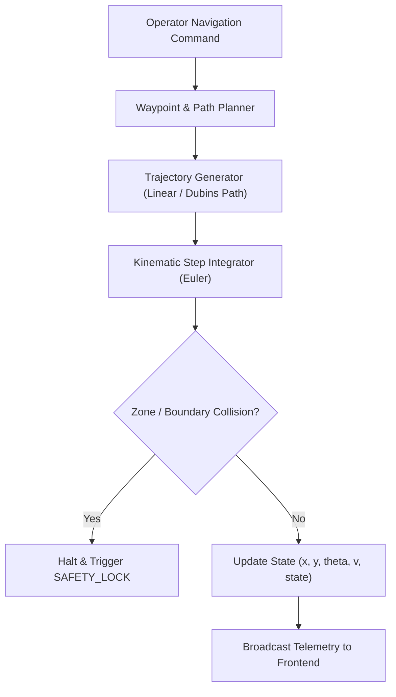

# AgriSentinel — Rover Simulation & Kinematics Engine

This document details the robotics simulation subsystem within **AgriSentinel**, explaining differential-drive kinematics, path interpolation, state machines, obstacle avoidance, and telemetry polling.

---

## 1. Simulation Architecture

---

## 2. Rover States & Transitions

The simulator implements a deterministic 11-state machine:

| State | Description | Allowed Next States |
| :--- | :--- | :--- |
| `IDLE` | Rover uninitialized; motors disarmed. | `READY`, `SAFETY_LOCK` |
| `READY` | Rover initialized at home/field origin; awaiting target waypoint. | `NAVIGATING`, `STOPPED`, `SAFETY_LOCK` |
| `NAVIGATING` | Rover actively traveling towards target waypoint along trajectory. | `ARRIVED`, `PAUSED`, `STOPPED`, `SAFETY_LOCK` |
| `PAUSED` | Navigation temporarily suspended; velocity zeroed. | `NAVIGATING`, `STOPPED`, `SAFETY_LOCK` |
| `ARRIVED` | Rover within arrival radius ($\le 0.15\text{ m}$) of target waypoint. | `INTERVENTION_PENDING`, `READY`, `SAFETY_LOCK` |
| `INTERVENTION_PENDING` | Rover stationary at target; awaiting operator actuation confirmation. | `INTERVENING`, `READY`, `SAFETY_LOCK` |
| `INTERVENING` | Actuator simulation running for treatment duration (e.g. 1.5s). | `COMPLETED`, `SAFETY_LOCK` |
| `COMPLETED` | Treatment finished; target marked completed; ready for next target. | `READY`, `IDLE`, `SAFETY_LOCK` |
| `STOPPED` | Mission manually terminated by operator. | `READY`, `IDLE` |
| `SAFETY_LOCK` | Emergency Stop triggered or safety violation detected; all controls locked. | `IDLE` (via explicit reset) |
| `ERROR` | Kinematic or boundary exception occurred. | `IDLE`, `SAFETY_LOCK` |

---

## 3. Kinematic Motion Model

The rover is modeled as a differential-drive ground robot with wheel separation $L = 0.65\text{ m}$ and nominal linear cruising speed $v_{\text{nom}} = 0.8\text{ m/s}$.

### Update Equations
Given current state $(x_t, y_t, \theta_t)$ and target $(x_g, y_g)$:

1. **Heading Delta**:
   $$\theta_{\text{goal}} = \text{atan2}(y_g - y_t, x_g - x_t)$$
   $$\Delta \theta = \text{atan2}(\sin(\theta_{\text{goal}} - \theta_t), \cos(\theta_{\text{goal}} - \theta_t))$$

2. **Angular Velocity Control**:
   $$\omega = \text{clip}(k_p \cdot \Delta \theta, -\omega_{\text{max}}, \omega_{\text{max}})$$
   where $k_p = 2.0\text{ s}^{-1}$ and $\omega_{\text{max}} = 1.2\text{ rad/s}$.

3. **Position Integration (Step Time $\Delta t$)**:
   $$\theta_{t+\Delta t} = \theta_t + \omega \Delta t$$
   $$x_{t+\Delta t} = x_t + v \cos(\theta_{t+\Delta t}) \Delta t$$
   $$y_{t+\Delta t} = y_t + v \sin(\theta_{t+\Delta t}) \Delta t$$

---

## 4. Boundary & Restricted Zone Collision Checks

At every step, the simulator verifies that:
1. $0 \le x_t \le W_{\text{field}}$ and $0 \le y_t \le H_{\text{field}}$.
2. Rover coordinates do not intersect any defined restricted buffer polygons (e.g. irrigation ditches, field boundaries, or water ways).

If a violation occurs, the simulator immediately transitions to `SAFETY_LOCK` and zeroes velocity.
