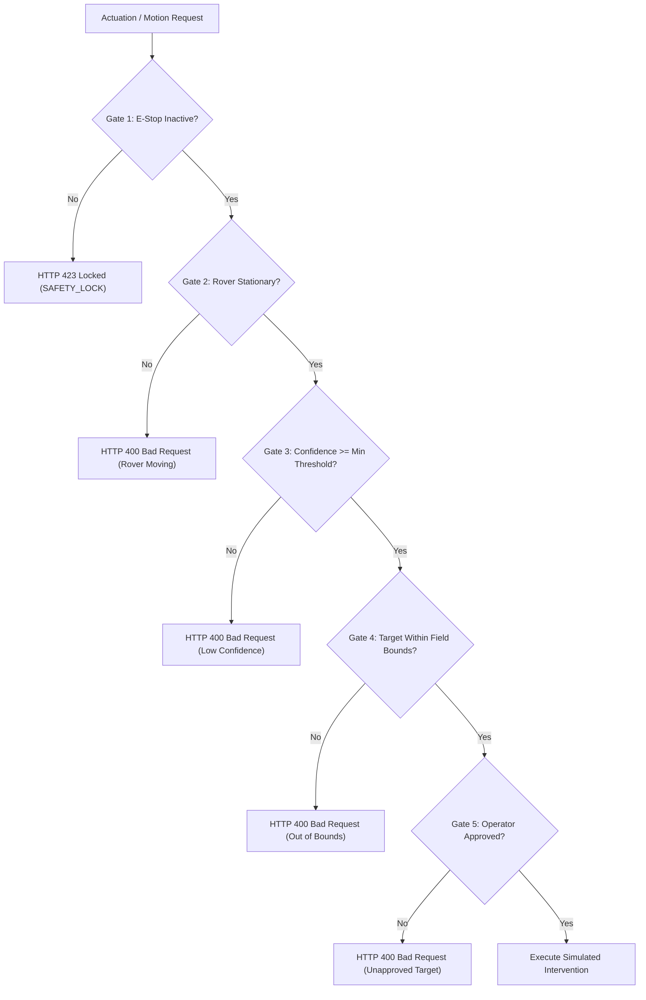

# AgriSentinel — Multi-Tier Safety & Interlock System

Safety is paramount in precision agricultural robotics. This document defines the multi-tier safety architecture, interlock checks, emergency stop mechanisms, and fail-safe protocols implemented across **AgriSentinel**.

---

## 1. Safety Architecture Overview

---

## 2. The Five Interlock Gates

### Gate 1: Emergency Stop Interlock (`SAFETY_LOCK`)
- **Condition**: Rover state $\ne$ `SAFETY_LOCK` and $\ne$ `ERROR`.
- **Trigger**: Can be invoked at any microsecond via `POST /api/rover/emergency-stop` or physical hardware E-Stop switch.
- **Action**: Cuts all motor drive outputs, halts waypoint execution, disarms virtual actuator solenoid, and logs an emergency stop incident.
- **Recovery**: Requires an explicit, intentional reset via `POST /api/rover/reset`.

### Gate 2: Kinematic Stability Gate
- **Condition**: Linear velocity $|v| \le 0.05\text{ m/s}$ and positional error $\text{dist}(\text{rover}, \text{target}) \le 0.25\text{ m}$.
- **Purpose**: Prevents premature spraying or actuator firing while the platform is still in motion, preventing drift and off-target chemical deposition.

### Gate 3: Vision Confidence Gating
- **Condition**: Target detection confidence $C(t) \ge \theta_{\text{min}}$ (configured in system settings, default $0.35$).
- **Purpose**: Prevents treating ambiguous detections, shadows, or low-probability crop anomalies.

### Gate 4: Boundary & Geo-Fence Containment
- **Condition**: Target coordinates $(x_t, y_t) \in \mathcal{P}_{\text{field}}$ and $(x_t, y_t) \notin \mathcal{P}_{\text{restricted}}$.
- **Purpose**: Protects field edges, waterways, public roads, and protected vegetative buffer strips.

### Gate 5: Operator Confirmation Interlock
- **Condition**: Target status $=$ `APPROVED` and request payload includes `confirmed: true`.
- **Purpose**: Ensures human-in-the-loop oversight before any simulated or physical intervention is committed.

---

## 3. Fail-Safe Protocols

| Failure Scenario | Automatic System Response |
| :--- | :--- |
| **Loss of Telemetry / Heartbeat** | Rover transitions to `PAUSED` after 3.0 seconds without keepalive. |
| **Model Load Failure** | System falls back to Classical Heuristic and flags UI with warning banner. |
| **Database Disconnection** | API routes enter read-only degraded mode (`/api/health` reports degraded). |
| **Boundary Violation** | Rover transitions immediately to `SAFETY_LOCK` with velocity $0$. |
| **Emergency Stop Commanded** | Immediate hard interrupt; all actions aborted and locked. |
