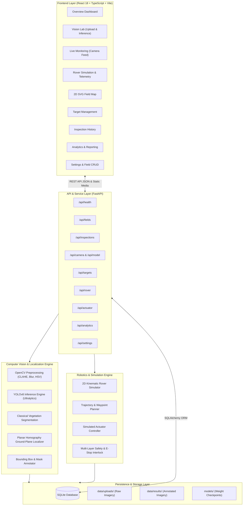
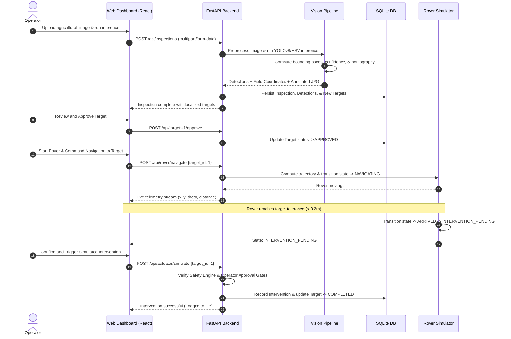

# AgriSentinel — System Architecture

This document provides a comprehensive technical overview of the **AgriSentinel** platform architecture, detailing component interactions, data flow, safety interlocks, computer vision pipelines, and database models.

---

## 1. High-Level Architecture Diagram

---

## 2. Component Breakdown

### 2.1 Frontend Client (`frontend/src/`)
Built with **React 18**, **TypeScript**, and **Vite**, using a hand-crafted CSS design system inspired by high-density mission-control interfaces.
- **State Management**: React Context API (`FieldContext`, `FieldProvider`) managing active field selection, telemetry synchronization, and target states.
- **Visual Map Engine**: 2D SVG canvas rendering field boundaries, crop rows, restricted zones, real-time rover heading, and target markers.
- **Responsive Telemetry Stream**: Polling intervals synchronize rover position, velocity, heading, and state machine transitions.

### 2.2 Backend API Gateway (`backend/app/`)
Developed with **FastAPI** and **Pydantic** for high-throughput asynchronous execution and strict validation.
- **Modular Routers**: Isolated endpoint routers for fields, inspections, targets, rover telemetry, actuator triggers, and analytics.
- **Static File Server**: Mounted `/media` static router serving raw uploads and annotated results securely.
- **Dependency Injection**: SQLAlchemy session management with transactional integrity and rollback handling.

### 2.3 Computer Vision Pipeline (`backend/app/services/`)
- **`preprocessing.py`**: Performs CLAHE (Contrast Limited Adaptive Histogram Equalization), bilateral filtering, color conversions, and image resizing.
- **`inference.py`**: Wraps Ultralytics `YOLO` model loader with safe error trapping. Evaluates class thresholds and provides transparent fallback to classical HSV green-excess indexing ($2G - R - B$).
- **`localization.py`**: Calculates perspective transformation matrices ($3 \times 3$ homography) mapping image pixels $(u, v)$ to field coordinates $(x, y)$ in meters.

### 2.4 Robotics Simulator & Safety Core
- **`rover_simulator.py`**: Simulates 2D differential-drive kinematics with Euler integration. Updates position, heading, velocity, and distance-to-waypoint at discrete time steps ($\Delta t$).
- **`safety.py`**: Evaluates operating parameters against safety thresholds (e.g. maximum navigation speed, target confidence $> \theta_{\text{min}}$, non-emergency status, boundary containment).
- **`actuator.py`**: Simulates precision spot application with safety interlocks, operator approval gating, and duration timers.

---

## 3. End-to-End Sequence Diagram

---

## 4. Security & Isolation Boundaries

1. **Local-First Sandboxing**: By default, AgriSentinel runs locally on `127.0.0.1`. No data or imagery leaves the host machine.
2. **File Validation**: Strict MIME-type checking, file size ceilings (max 50MB), and path sanitization prevent path traversal attacks.
3. **Emergency Disconnect**: The Emergency Stop endpoint (`POST /api/rover/emergency-stop`) immediately locks the simulator and disarms actuator triggers at the service layer.
