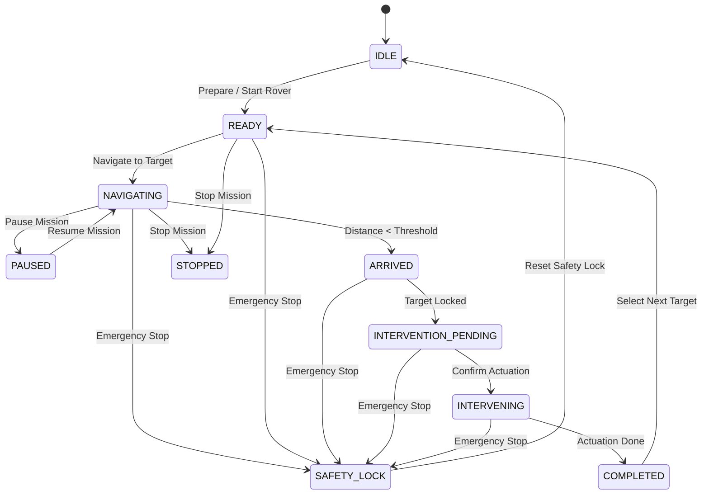
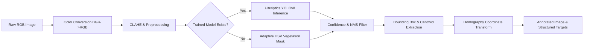

# AgriSentinel — Technical Design Document (TDD)

This technical design document outlines the mathematical models, software engineering patterns, state machines, and data structures implemented in **AgriSentinel**.

---

## 1. Domain Modeling & Mathematical Formulations

### 1.1 Planar Homography for Target Localization
The vision system maps 2D image pixel coordinates $\mathbf{p} = \begin{bmatrix} u & v & 1 \end{bmatrix}^T$ to 2D field ground coordinates $\mathbf{P}_w = \begin{bmatrix} X_w & Y_w & 1 \end{bmatrix}^T$ via a $3 \times 3$ homography matrix $\mathbf{H}$:

$$\mathbf{p} = s \mathbf{H} \mathbf{P}_w$$

where $s$ is an arbitrary scale factor. Inverted for target localization:

$$\mathbf{P}_w = \mathbf{H}^{-1} \mathbf{p}$$

In default simulated mode with a nadir camera footprint of width $W_{\text{cam}}$ and height $H_{\text{cam}}$ centered at rover position $(x_r, y_r)$ with heading $\theta$:

$$X_{\text{target}} = x_r + \left(\frac{u - u_{\text{center}}}{W_{\text{img}}}\right) W_{\text{cam}} \cos\theta - \left(\frac{v - v_{\text{center}}}{H_{\text{img}}}\right) H_{\text{cam}} \sin\theta$$

$$Y_{\text{target}} = y_r + \left(\frac{u - u_{\text{center}}}{W_{\text{img}}}\right) W_{\text{cam}} \sin\theta + \left(\frac{v - v_{\text{center}}}{H_{\text{img}}}\right) H_{\text{cam}} \cos\theta$$

---

### 1.2 Target Priority Formulation
Targets are ranked dynamically using a multi-factor priority score $P(t) \in [0, 1]$:

$$P(t) = w_c \cdot C(t) + w_s \cdot S(c) + w_d \cdot D(t, r)$$

Where:
* $C(t) \in [0, 1]$ is the detection confidence score.
* $S(c) \in [0, 1]$ is the class severity weight (e.g., invasive weed $= 0.9$, general weed $= 0.7$, crop anomaly $= 0.5$).
* $D(t, r) = \max\left(0, 1 - \frac{\text{dist}(t, r)}{D_{\text{max}}}\right)$ is the proximity discount factor relative to current rover position $r$.
* Default weights: $w_c = 0.4$, $w_s = 0.4$, $w_d = 0.2$.

---

### 1.3 Rover Kinematics & Waypoint Navigation
The simulator implements a 2D differential-drive kinematics model:

$$\dot{x} = v \cos\theta, \quad \dot{y} = v \sin\theta, \quad \dot{\theta} = \omega$$

At each simulation tick with time step $\Delta t$:
1. Compute heading error: $\Delta \theta = \text{atan2}(Y_{\text{target}} - y, X_{\text{target}} - x) - \theta$ (normalized to $[-\pi, \pi]$).
2. Compute Euclidean distance to goal: $d = \sqrt{(X_{\text{target}} - x)^2 + (Y_{\text{target}} - y)^2}$.
3. If $d \le d_{\text{arrival}}$ (default $0.15\text{ m}$), velocity $v \leftarrow 0$, state transitions to `ARRIVED`.
4. Otherwise, position is integrated: $x_{t+\Delta t} = x_t + v_{\text{nominal}} \cos(\theta) \Delta t$, $y_{t+\Delta t} = y_t + v_{\text{nominal}} \sin(\theta) \Delta t$.

---

## 2. Rover Finite State Machine (FSM)



---

## 3. Computer Vision Subsystem Architecture



### Detection Schema
```json
{
  "id": "det_9aa32904",
  "class_name": "weed",
  "confidence": 0.88,
  "bbox": {
    "x": 210,
    "y": 145,
    "width": 85,
    "height": 70
  },
  "center": {
    "x": 252,
    "y": 180
  },
  "field_coords": {
    "x": 12.45,
    "y": 8.32
  },
  "source": "uploaded_image"
}
```

---

## 4. Multi-Tier Safety Engine

Every simulated actuator intervention must pass 5 consecutive safety gates before firing:

1. **Gate 1: Emergency Stop Interlock**: System must not be in `SAFETY_LOCK` or `ERROR` state.
2. **Gate 2: Rover Stationary Check**: Rover velocity $|v| \le 0.05\text{ m/s}$ and distance to target $\le 0.25\text{ m}$.
3. **Gate 3: Confidence Gating**: Target detection confidence must meet or exceed minimum threshold ($\ge \theta_{\text{min}}$).
4. **Gate 4: Boundary & Restricted Zone Compliance**: Target coordinates must reside within field polygon and outside all restricted buffers.
5. **Gate 5: Operator Authorization Gate**: If operator confirmation is required in settings, an explicit operator token/confirmation must accompany the request.

If any gate fails, an `HTTP 400 Bad Request` or `HTTP 423 Locked` is returned with a descriptive safety violation payload.
