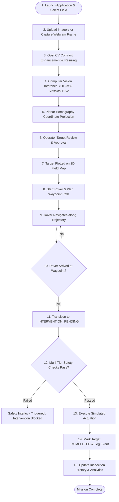

# AgriSentinel — End-to-End Mission Workflow

This document illustrates the complete end-to-end operational lifecycle in **AgriSentinel**, from initial field setup to image acquisition, computer vision inference, target localization, operator approval, autonomous rover navigation, simulated treatment, and analytics auditing.

---

## 1. Full Product Flowchart

---

## 2. Step-by-Step Stage Breakdown

### Stage 1: Field Definition & Setup
- The operator navigates to **Settings** or **Overview** and selects or creates a field parcel (e.g. `North Parcel Alpha`, 50m $\times$ 30m, Crop: `Soybean`).
- Field parameters define boundary limits, crop row spacing, and restricted buffer zones.

### Stage 2: Image Acquisition & Preprocessing
- Imagery is ingested via the **Vision Lab** (uploading JPG/PNG/MP4 files) or the **Live Monitoring** camera interface.
- OpenCV applies image format normalization, bilateral filtering for noise reduction, and CLAHE for ambient lighting equalization.

### Stage 3: Computer Vision Inference
- The preprocessed frame passes through the detection engine:
  - If a custom model checkpoint exists (`models/weed_crop_model.pt`), Ultralytics YOLOv8 evaluates features and outputs crop/weed classes with confidence scores.
  - If no custom model is mounted, the classical vegetation heuristic evaluates excess-green color channels ($2G - R - B$) to isolate plant clusters.
- Bounding boxes, centroids, and classification labels are generated.

### Stage 4: Target Localization & Prioritization
- The homography engine translates image centroid coordinates $(u, v)$ into metric field coordinates $(X_w, Y_w)$.
- Targets are scored by priority based on confidence, weed severity, and distance to current rover position.

### Stage 5: Operator Review & Approval
- On the **Targets** page, the operator audits newly detected targets.
- The operator can **Approve**, **Reject**, or adjust target status.

### Stage 6: Field Map Visualization & Path Planning
- Approved targets are displayed on the **Field Map** alongside crop rows and the virtual rover icon.
- The rover simulator computes Euclidean waypoint trajectories avoiding restricted zones.

### Stage 7: Autonomous Rover Navigation
- On the **Rover Simulation** page, the operator initializes the rover (`READY`) and selects a target waypoint.
- The rover transitions to `NAVIGATING`, updating velocity, heading, and distance-to-target in real time.
- If an emergency stop is triggered, navigation halts immediately and the rover enters `SAFETY_LOCK`.

### Stage 8: Simulated Intervention & Safety Interlocks
- Upon reaching within $0.2\text{ m}$ of the target, the rover halts and enters `INTERVENTION_PENDING`.
- The operator confirms actuation. The safety engine verifies:
  1. No active emergency stop
  2. Rover is stationary
  3. Target is within field boundaries
  4. Detection confidence meets threshold
- Simulated spot treatment executes for the configured duration (e.g., $1.5\text{ s}$).

### Stage 9: History & Analytics Auditing
- The intervention is recorded with timestamps in the SQLite database.
- Target status updates to `COMPLETED`.
- **Inspection History** and **Analytics** dynamically reflect updated treatment tallies, chemical volume savings, and operational timelines.
